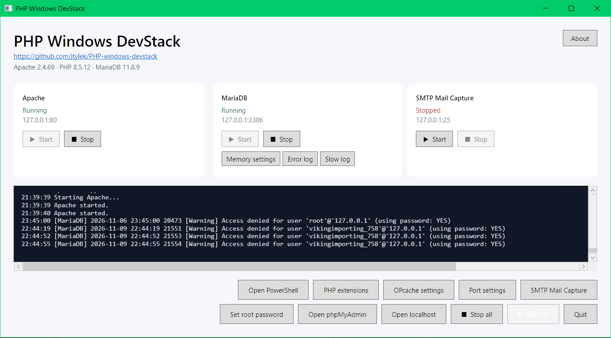

# PHP Windows DevStack

A native, portable Windows development environment for PHP applications. It combines
**Apache HTTP Server**, **PHP 8.5**, **MariaDB**, **phpMyAdmin** and
**[Mailpit](https://github.com/axllent/mailpit)** (local mail capture with a web inbox)
behind a small desktop control panel. No Docker required.

## Download for Windows

**[Download the latest release: 1.0 RC14](https://github.com/jtylek/PHP-windows-devstack/releases/tag/v1.0.0-rc.14)**
(Windows 10/11 x64; all versions are on the [Releases page](https://github.com/jtylek/PHP-windows-devstack/releases)). Run the setup EXE; the default folder is `C:\PHPDevStack`.

> Project status: ready for development use on a local or trusted private network; not
> for production hosting. The installer is unsigned, so Windows SmartScreen may show an
> unknown-publisher warning.

## Defaults

| Service | Address |
| --- | --- |
| Apache (web root `www/`) | `http://127.0.0.1:8080` |
| phpMyAdmin | `http://127.0.0.1:8080/phpmyadmin` |
| MariaDB | `127.0.0.1:3307` (local only) |
| Mailpit SMTP / inbox | `127.0.0.1:25` / `http://127.0.0.1:8025` |

## Documentation

- [Installation and updating](docs/installation.md)
- [Using DevStack](docs/usage.md): phpMyAdmin, ports, LAN access, mail capture, PHP terminal, memory
- [Development](docs/development.md): stack details, build, runtime installation
- [MariaDB development profile](docs/mariadb-development-profile.md)
- [Architecture](docs/architecture.md) and [Security](SECURITY.md)

## License

The DevStack control-panel source is MIT licensed. Bundled third-party
components retain their own licenses and notices; see
[`THIRD_PARTY_NOTICES.md`](THIRD_PARTY_NOTICES.md).
